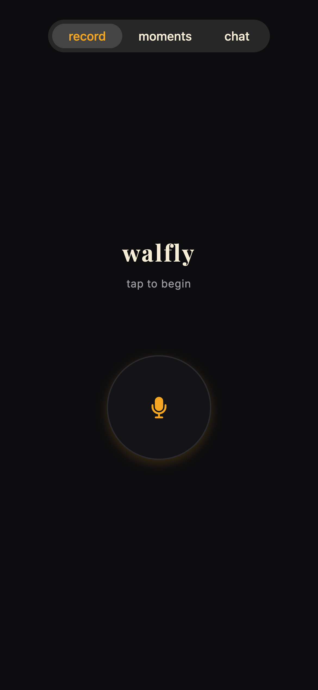
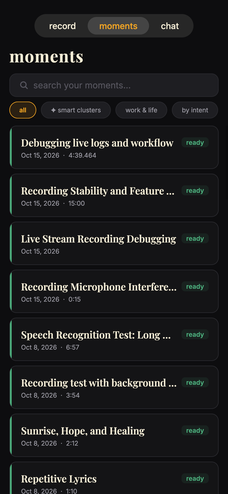
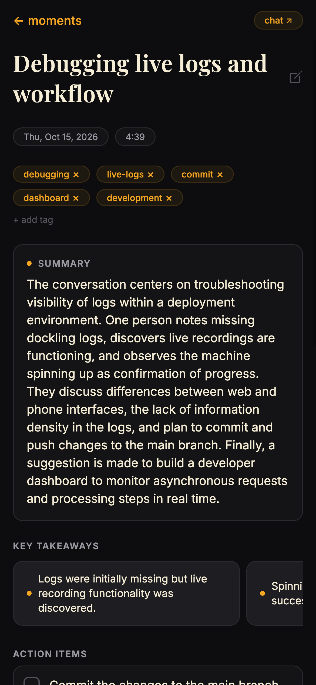
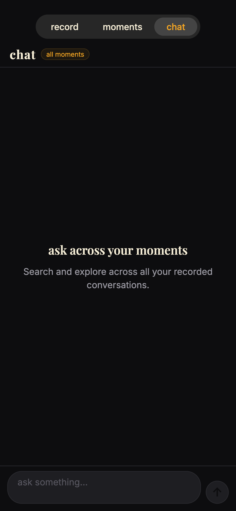
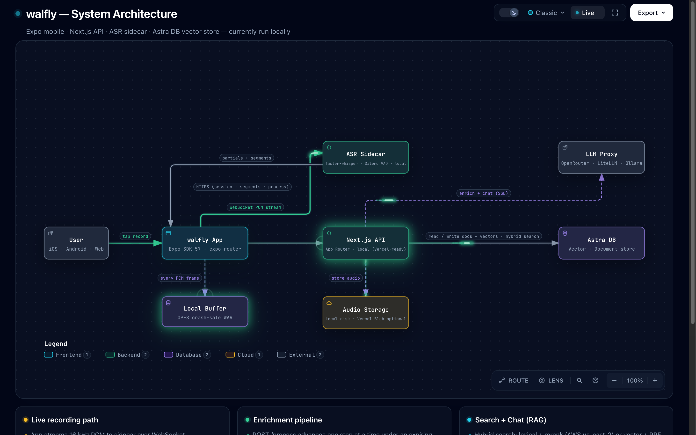
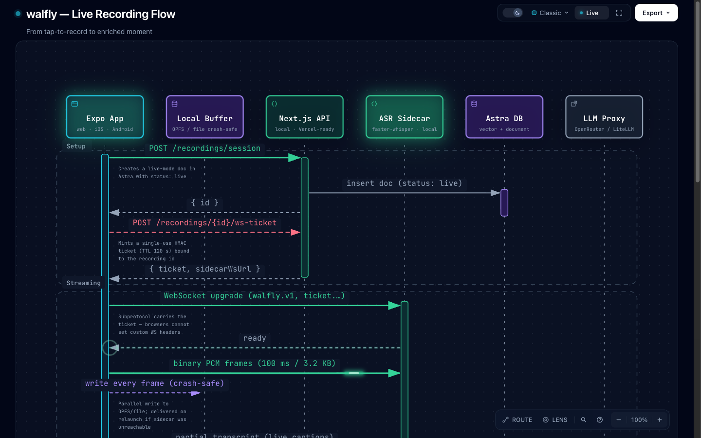

<div align="center">

<pre>
██╗    ██╗ █████╗ ██╗     ███████╗██╗  ██╗   ██╗
██║    ██║██╔══██╗██║     ██╔════╝██║  ╚██╗ ██╔╝
██║ █╗ ██║███████║██║     █████╗  ██║   ╚████╔╝
██║███╗██║██╔══██║██║     ██╔══╝  ██║    ╚██╔╝
╚███╔███╔╝██║  ██║███████╗██║     ███████╗██║
 ╚══╝╚══╝ ╚═╝  ╚═╝╚══════╝╚═╝     ╚══════╝╚═╝
</pre>

[](https://expo.dev)
[](https://nextjs.org)
[](https://astra.datastax.com)
[](https://www.typescriptlang.org)

</div>

---

## What is walfly?

**walfly** ("fly on the wall") is a passive conversation recorder. Tap to begin. Talk. Tap to stop. Everything else happens automatically.

The app captures audio, transcribes it with speech recognition, enriches it with AI-generated summaries, key takeaways, and action items, then stores everything in a searchable, vector-indexed library you can chat with — all from a single button.

<table>
<tr>
<td align="center" width="25%">

**record**



One button. Midnight background. Amber glow ring. Tap to begin.

</td>
<td align="center" width="25%">

**moments**



Your library. AI-titled cards, smart clusters, hybrid search.

</td>
<td align="center" width="25%">

**detail**



Summary, key takeaways, action items, collapsible transcript.

</td>
<td align="center" width="25%">

**chat**



RAG-grounded streaming chat across all your moments.

</td>
</tr>
</table>

---

## What we're trying to accomplish

| Layer | What walfly does |
|---|---|
| **Capture** | One-tap recording on web, iOS, and Android from a single codebase |
| **Transcription** | Real-time streaming ASR via [faster-whisper](https://github.com/SYSTRAN/faster-whisper) sidecar with live captions; full-fidelity file transcription as fallback |
| **Enrichment** | LLM-generated title, summary, key takeaways, and action items for every recording |
| **Memory** | Hybrid vector + lexical search across all your recordings — ask anything, find anything |
| **Conversation** | Chat with a single recording or across your entire library with RAG-grounded answers |

---

## Architecture

[](.archify/architecture-walfly-20250724-120000/walfly-architecture.html)

<sub>↑ Click to open the interactive diagram — [**walfly — System Architecture**](.archify/architecture-walfly-20250724-120000/walfly-architecture.html)</sub>

### How a live recording flows

[](.archify/sequence-recording-20250724-120000/walfly-sequence.html)

<sub>↑ Click to open the interactive diagram — [**walfly — Live Recording Flow**](.archify/sequence-recording-20250724-120000/walfly-sequence.html)</sub>

Every finalized segment is checkpointed to [Astra DB](https://astra.datastax.com) before being acknowledged to the sidecar. If the connection drops, the sidecar replays unacknowledged segments. If the app dies, a local OPFS buffer delivers the full recording on the next launch. **Nothing you say is lost.**

> **Deployment status:** walfly is Docker-first and host-agnostic. Own a box (VPS, homelab)? `./deploy.sh` is one step — it bundles self-hosted object storage and automatic HTTPS and brings up the whole stack. Prefer a managed platform? Render deploys both services from one Blueprint click; Fly and DigitalOcean manifests are included too. See `SETUP.md`'s "Deployment" section.

---

## Stack

| Layer | Technology | Why |
|---|---|---|
| **Frontend** | [Expo](https://expo.dev) SDK 57 + [expo-router](https://expo.github.io/router) | One codebase for web, iOS, Android |
| **API** | [Next.js](https://nextjs.org) 16 App Router, Dockerized (`output: 'standalone'`) | Host-agnostic — runs anywhere Docker runs |
| **ASR** | [faster-whisper](https://github.com/SYSTRAN/faster-whisper) + [Silero VAD](https://github.com/snakers4/silero-vad) sidecar, Dockerized | Real-time streaming transcription; LocalAgreement-2 for stable partials |
| **Transcription (file)** | [Docling](https://github.com/docling-project/docling) SaaS | Timestamped markdown output; no local Python needed |
| **Database** | [Astra DB](https://astra.datastax.com) (DataStax) | Vector store + document DB; built-in NVIDIA embeddings |
| **Vector search** | Hybrid lexical + rerank (AWS `us-east-2`) / vector + RRF (all regions) | Semantic + keyword search across all recordings |
| **LLM** | OpenAI-compatible proxy ([OpenRouter](https://openrouter.ai) / [LiteLLM](https://github.com/BerriAI/litellm) / [Ollama](https://ollama.com)) | Swap any model without code changes via env vars |
| **Audio storage** | Local `.data/audio/` (dev only) / S3-compatible object storage ([AWS S3](https://aws.amazon.com/s3/) / [Cloudflare R2](https://www.cloudflare.com/developer-platform/products/r2/) / [Backblaze B2](https://www.backblaze.com/cloud-storage) / MinIO) in production | Zero-config local fallback; works identically against any S3-compatible provider |
| **Auth** | Single shared bearer token (`WALFLY_API_TOKEN`) | Gates every API route except `/health` and `/wiki/*` |
| **Language** | [TypeScript](https://www.typescriptlang.org) end-to-end | Shared types between API and mobile |

---

## App screens

### `record`

One screen. One button. Midnight background, amber glow ring. Tap to start; tap to stop. Live captions appear as you speak.

- Location is captured silently at record-start and reverse-geocoded to a human-readable place name
- A crash-safe local buffer writes every frame to disk in parallel with the WebSocket stream
- After stop: the recording is enriched automatically — title, summary, takeaways, action items

### `moments`

A scrollable list of every recording, sorted by date. Each card shows the AI-generated title, location, duration, and status.

- Search bar at the top runs hybrid vector + keyword search across all recordings
- Status badges: `uploading` · `transcribing` · `enriching` · `ready` · `failed`
- Tap any card to open the detail view

### Recording detail

The full enriched view: editable title, summary card, key takeaways as chips, action items as a checklist, and a collapsible full transcript with timestamps.

- Inline editing for title, tags, notes, and place name
- Delete with confirmation removes the blob and the database record

### `chat`

A streaming chat interface, token-by-token, powered by RAG.

- **Per-recording**: "chat about this" from the detail screen — the transcript is the context
- **Global**: Tab 3 — vector search injects relevant titles, summaries, and takeaways from across your library as context
- Amber user bubbles · dark assistant bubbles · amber streaming dot

---

## Getting started

### Prerequisites

- Node.js 20+
- [`uv`](https://docs.astral.sh/uv/) (Python package manager, for the ASR sidecar)
- An [Astra DB](https://astra.datastax.com) Serverless (Vector) database
- An LLM proxy key ([OpenRouter](https://openrouter.ai), [LiteLLM](https://github.com/BerriAI/litellm), or local [Ollama](https://ollama.com))

### Install

```bash
git clone https://github.com/SonicDMG/walfly && cd walfly
npm install
```

### Configure

```bash
cp packages/api/.env.example packages/api/.env.local   # fill in your keys
cp apps/mobile/.env.example  apps/mobile/.env          # set EXPO_PUBLIC_API_URL
```

Minimum required variables:

| Variable | Where | What |
|---|---|---|
| `ASTRA_DB_API_ENDPOINT` | `packages/api/.env.local` | Your Astra DB API endpoint |
| `ASTRA_DB_APPLICATION_TOKEN` | `packages/api/.env.local` | Astra admin token |
| `WALFLY_WS_SECRET` | `packages/api/.env.local` | `openssl rand -hex 32` |
| `LLM_API_KEY` | `packages/api/.env.local` | Your LLM proxy key |
| `LLM_MODEL` | `packages/api/.env.local` | e.g. `openai/gpt-4o` |
| `EXPO_PUBLIC_API_URL` | `apps/mobile/.env` | `http://localhost:3030` for web |

### Seed the database

```bash
npm run seed --workspace=packages/db
```

Creates two [Astra DB](https://astra.datastax.com) collections:

- `recordings_v2` — [NVIDIA](https://build.nvidia.com/nvidia/nv-embedqa-e5-v5) vector embeddings, hybrid lexical + rerank search (where the region supports it)
- `recording_chunks_v2` — no vector index; pure write-ahead log for live session segments

### Run

```bash
npm run dev          # sidecar + API (port 3030) + Expo — all together
npm run dev:api      # sidecar + API only
npm run dev:mobile   # Expo only
```

Press `w` in the Expo terminal to open the web app at `http://localhost:8081`.

### Verify

```bash
curl -s http://localhost:3030/api/health | jq
```

```json
{
  "status": "ok",
  "service": "walfly-api",
  "checks": {
    "astra": "ok",
    "collection": "ok",
    "llm": "configured",
    "storage": "local"
  }
}
```

---

## Monorepo layout

```
walfly/
├── apps/
│   └── mobile/              # Expo app — web, iOS, Android
│       ├── app/(tabs)/      # record · moments · chat screens
│       ├── app/recording/   # recording detail screen
│       └── lib/             # theme tokens, types, hooks
├── packages/
│   ├── api/                 # Next.js API
│   │   ├── app/api/         # route handlers
│   │   ├── lib/             # transcribe · enrich · llm · store
│   │   └── sidecar/         # Python ASR sidecar (Dockerfile + fly.toml)
│   └── db/                  # Astra DB client, schema, types
├── research_notes/          # architecture decisions and research
├── deploy.sh                # one-step VPS/homelab deploy (see SETUP.md)
├── docker-compose.yml       # api + sidecar + garage + caddy, for deploy.sh
├── Caddyfile                # automatic HTTPS / routing, for docker-compose.yml
├── render.yaml              # one-click Render Blueprint (both services)
└── digitalocean-app.yaml    # DigitalOcean App Platform spec (both services)
```

`apps/mobile` deliberately does **not** import `@walfly/db` — wire types are mirrored in `apps/mobile/lib/types.ts` so [Metro](https://metrobundler.dev) never pulls the [Astra DB](https://astra.datastax.com) driver into the client bundle.

---

## Roadmap

- [x] Project scaffolding and monorepo setup
- [x] [Astra DB](https://astra.datastax.com) schema with vector embeddings
- [x] Upload pipeline (transcribe → enrich → store)
- [x] Hybrid search (vector + lexical)
- [x] Record screen with location
- [x] Recordings library with search
- [x] Recording detail with inline editing
- [x] Streaming chat (per-recording + global RAG)
- [x] Streaming ASR sidecar ([faster-whisper](https://github.com/SYSTRAN/faster-whisper) + [Silero VAD](https://github.com/snakers4/silero-vad))
- [x] Live captions via WebSocket
- [x] Crash-safe local buffer with recovery upload
- [x] Dockerize the API and sidecar; drop the Vercel-specific storage/upload-cap code paths entirely
- [x] Shared bearer-token auth across the API and mobile app
- [ ] Live rolling enrichment (phase 2)
- [ ] Multi-user auth (currently one shared token, not per-user accounts)
- [ ] Apple Watch companion (ST-9)

---

## Contributing

See [CONTRIBUTING.md](CONTRIBUTING.md) for the contribution guide and [SETUP.md](SETUP.md) for full environment and operations documentation.

---

<div align="center">
<sub>walfly — <em>the moments you were there for.</em></sub>
</div>
